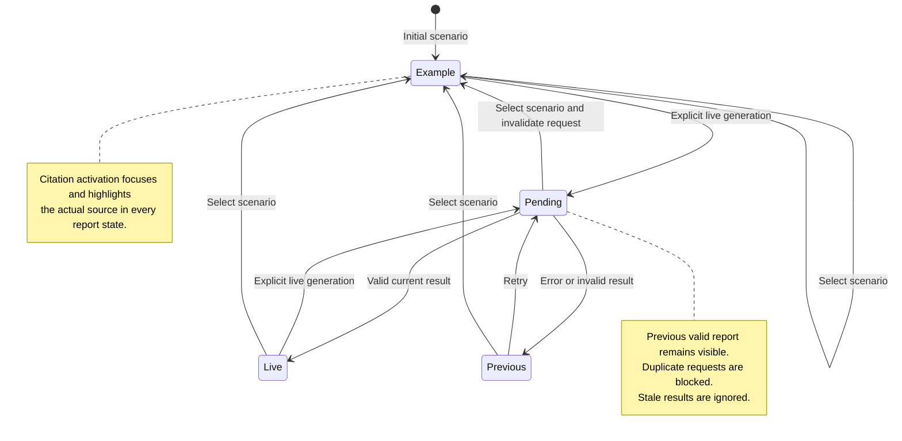

# Architecture

IncidentLens is one Next.js App Router application. Bundled JSON and server validation support a credential-free demonstration; the same report contract also supports an optional local live request. There is no database or persistent history.

## System boundaries

```mermaid
flowchart TD
  subgraph runtime["Application runtime"]
    E["Bundled evidence JSON"] --> L["Server scenario loader"]
    R["Saved report JSON"] --> L
    L --> V["Schema, citations, and bundle hash"]
    V --> P["Server-rendered page"]
    P --> U["Interactive investigation workspace"]
    U -->|"Explicit local request"| A["Generation route and policy gate"]
    A --> G["Bounded generation service"]
    G --> O["Server-only OpenAI adapter"]
    O --> X["OpenAI Responses API"]
    G -->|"Validated artifact"| U
  end
  subgraph offline["Evaluation process only"]
    C["Cases and review annotations"] --> H["TypeScript evaluation harness"]
    H --> Z["Per-dimension results"]
  end
```



The page loads three validated scenario views on the server and passes their display data, evidence, and saved artifacts to the interactive workspace. All three bundles are intentionally available to the browser for immediate selection. They contain synthetic data only.

The display catalogue in [scenarios.ts](../src/server/scenarios.ts) supplies descriptive titles. The generation service calls `loadBundle` and passes the neutral bundle alone to prompt construction. Saved reports, catalogue labels, evaluation answers, and filenames are not model input.

The evaluation process imports shared contracts and its own fixtures. Runtime source does not import evaluation cases or annotations. Server modules containing loader/provider behavior use `server-only`; client-side contract validation does not import a provider or credentials.

| Boundary                 | Main source                                            | Responsibility                                                    |
| ------------------------ | ------------------------------------------------------ | ----------------------------------------------------------------- |
| Shared contracts         | [contracts.ts](../src/lib/contracts.ts)                | Evidence/report shapes, timestamps, unique IDs, scoped references |
| Saved-artifact integrity | [integrity.ts](../src/lib/integrity.ts)                | Canonical bundle hash and compatibility                           |
| Server page              | [page.tsx](../src/app/page.tsx)                        | Load validated scenario views; compute UI live availability       |
| Interactive workspace    | [workspace.tsx](../src/components/workspace.tsx)       | Scenario selection, citations, current report, request lifecycle  |
| Thin HTTP route          | [route.ts](../src/app/api/generate/route.ts)           | Inject environment, loader, and provider; minimal diagnostics     |
| Generation service       | [generation.ts](../src/server/generation.ts)           | Mode gate, request limits, deadline, retry budget, envelope       |
| Provider adapter         | [openai-provider.ts](../src/server/openai-provider.ts) | Lazy official SDK, structured output, refusal/incomplete handling |
| Prompt                   | [prompt.ts](../src/server/prompt.ts)                   | Versioned policy and untrusted-data separation                    |
| Offline evaluation       | [runner.ts](../evaluation/runner.ts)                   | Separate dimensions and exact-fixture review                      |

## Optional live request

```mermaid
sequenceDiagram
  participant UI as Workspace
  participant RT as Request handler
  participant GS as Generation service
  participant SDK as OpenAI adapter
  participant API as Responses API
  UI->>RT: scenarioId only
  RT->>RT: Enforce local mode and validate body
  alt Live disabled or request invalid
    RT-->>UI: Typed error; preserve valid report
  else Allowed and configured
    RT->>GS: Fixed validated bundle and server model
    loop At most 2 attempts within 20 seconds
      GS->>SDK: Evidence, remaining deadline, output budget
      SDK->>API: Structured output; no tools; SDK retries off
      API-->>SDK: Completed, refused, incomplete, or error
      SDK-->>GS: Parsed result or classified error
      GS->>GS: Validate report shape and source references
      Note over GS: Stop on success or terminal failure; only structural/citation failures allow correction
    end
    GS-->>RT: Valid artifact or safe failure
    RT-->>UI: Artifact or typed error
    UI->>UI: Apply only if request version is current
  end
```

The thin POST route delegates gating and body handling to `handleGenerate` in `generation.ts`; the diagram’s Request handler represents that function. The separate Generation service participant represents `generateReport` in the same module.

A correction is a fresh generation with the same bundle and a structural/citation correction instruction. The service does not feed the previous invalid report back to the model. Refusal, incomplete output, timeout, cancellation, and upstream failures terminate the generation rather than triggering this correction.

Both attempts share one 20-second service deadline. Each reserves at most 2,500 output tokens, with a 5,000-token total cap and no SDK retries. Body reading has its own earlier two-second deadline. These are per-generation bounds rather than an account-wide spending limit.

The application attaches provenance only after validation. A runtime-valid result can still contain a semantically unsupported proposition: deterministic validation checks shape and references, not general factual entailment.

## Workspace state



“Previous” represents the last valid example or live report after a failed request. A generation keeps that report visible. Selecting a scenario always installs its bundled example, invalidates the request version, and aborts the client controller. A request for an old scenario cannot replace the current report or error state.

The request guard uses a ref as well as disabled UI state, preventing rapid duplicate requests before a render. Client abort is best-effort; it does not guarantee provider cancellation or prevent charges.

Citation anchors are created from validated evidence IDs. Activation focuses the displayed source with `preventScroll`, scrolls it into view, and marks it selected. Untimed evidence and runbooks remain distinct from chronological events.

## Maintenance map

Changes to evidence normally affect saved artifacts and evaluation fixtures. Changes to report shapes affect shared contracts, structured output, examples, renderer, mocks, and review signatures. Follow [the contribution procedure](../CONTRIBUTING.md) rather than updating hashes or expected outcomes alone.

## Primary development references

These official links were recorded during implementation. They were not rechecked during this documentation-only update; use the pinned dependencies and current source when reproducing this checkout. Recheck provider/framework documentation before a version change or live model selection.

- [Next.js Route Handlers](https://nextjs.org/docs/app/api-reference/file-conventions/route)
- [Next.js data security](https://nextjs.org/docs/app/guides/data-security)
- [Next.js Vitest guide](https://nextjs.org/docs/app/guides/testing/vitest)
- [Next.js Playwright guide](https://nextjs.org/docs/app/guides/testing/playwright)
- [OpenAI structured outputs](https://developers.openai.com/api/docs/guides/structured-outputs)
