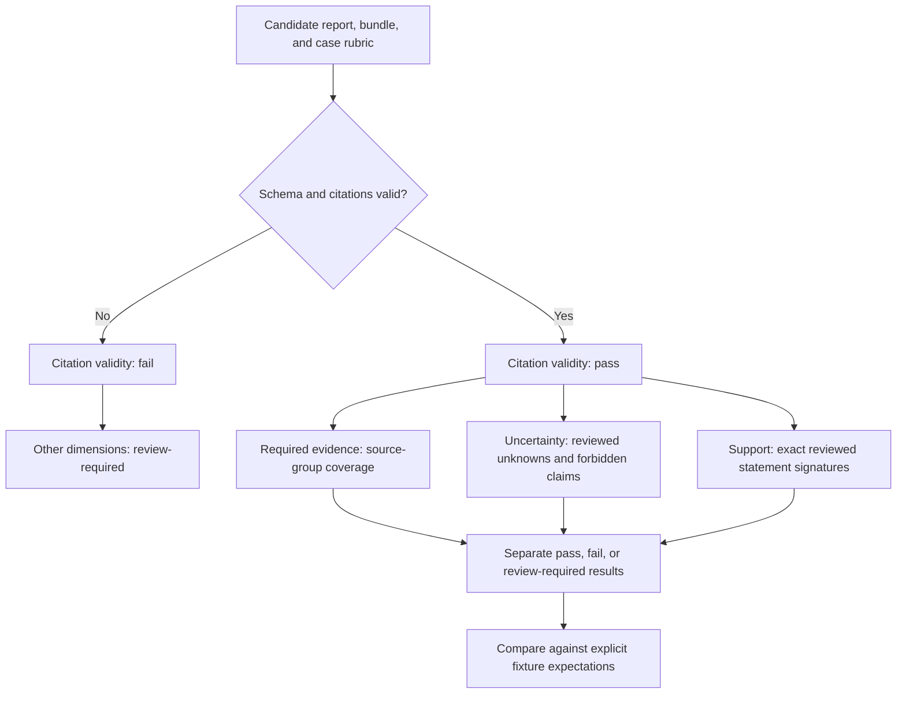

# Testing and evaluation

The default verification path is deterministic and uses no paid provider calls. Tests exercise runtime boundaries; evaluation fixtures exercise explicitly annotated report cases. Neither is a live-model quality benchmark.

## Commands and scope

| Command                 | Purpose                                                                     |
| ----------------------- | --------------------------------------------------------------------------- |
| `npm run typecheck`     | Generate Next.js route types and check strict TypeScript                    |
| `npm run lint`          | ESLint, TypeScript rules, and React hooks rules                             |
| `npm test`              | Vitest and React Testing Library unit/component tests                       |
| `npm run validate:data` | Validate three bundles and matching saved artifacts                         |
| `npm run eval`          | Evaluate closed fixtures and write per-dimension results                    |
| `npm run build`         | Validate bundled data, then produce a Next.js production build              |
| `npm run check`         | Type checking, lint, tests, evaluation, and build                           |
| `npm run test:e2e`      | Four Playwright Chromium tests against a separately built production server |
| `npm run format:check`  | Prettier check; separate from `check` and the current CI workflow           |

Install browser binaries first with `npx playwright install chromium`; Linux CI uses `--with-deps`. Browser tests use port 3107 and build/start their own server, independent of the interactive demo on 3100.

## Regression coverage

| Test file                                         | Current tests | Risks covered                                                                                      |
| ------------------------------------------------- | ------------: | -------------------------------------------------------------------------------------------------- |
| [contracts.test.ts](../tests/contracts.test.ts)   |            19 | IDs, timestamps, stable sorting, cross-scenario references, runbooks, hashes, provenance           |
| [generation.test.ts](../tests/generation.test.ts) |            21 | Mode/body gate, provider outcomes, deadline, correction budget, cancellation                       |
| [provider.test.ts](../tests/provider.test.ts)     |             5 | Official SDK request schema and mocked HTTP responses, refusal, incomplete output, retries         |
| [workspace.test.tsx](../tests/workspace.test.tsx) |             9 | Selection, citation focus, duplicate suppression, stale responses, errors preserving valid reports |
| [evaluation.test.ts](../tests/evaluation.test.ts) |             6 | Expected cases, reviewed signatures, separate support and reference validity                       |

The four browser tests cover the three-scenario journey and citation targets, production refusal of live generation, serious/critical automated desktop accessibility checks, and a 390×844 mobile journey with reduced motion and overflow checks. Automated checks do not establish complete accessibility compliance.

[CI](../.github/workflows/ci.yml) installs with `npm ci`, runs static/unit/evaluation checks, installs Chromium, then runs browser checks. The browser command includes a production build. Evaluation JSON and Playwright reports are configured as retained workflow artifacts. Remote CI execution has not been observed for this delivery.

## Evaluation flow



[cases.json](../evaluation/cases.json) contains a copied bundle, candidate report, rubric key, explicit expected statuses, and a note for each case. [rubrics.json](../evaluation/rubrics.json) records required signals, required unknowns, reviewed statement signatures, and known unsupported conclusions.

| Dimension         | What is checked                                                     | What a pass cannot establish                                   |
| ----------------- | ------------------------------------------------------------------- | -------------------------------------------------------------- |
| Citation validity | Shared schema and scenario-scoped reference integrity               | Whether cited text supports a proposition                      |
| Required evidence | Required signal groups with acceptable source IDs cited in findings | Whether prose correctly understands or discusses those signals |
| Uncertainty       | Exact reviewed unknowns and known forbidden conclusions             | General detection of unsupported certainty in novel prose      |
| Citation support  | Exact whole-statement signatures and known unsupported examples     | General entailment for new text                                |

Required-evidence coverage uses **covered signal groups / total required signal groups**, rather than counting any nonempty report as complete. Only summary, impact, observations, and hypotheses contribute their supporting `evidenceIds`; next checks and counterevidence alone do not satisfy it. A group is covered when any acceptable source ID appears. The result explicitly records `referencePresenceOnly: true`.

Support signatures include the whole statement, including gaps/rationale and references. Known text paired with a source set outside its reviewed support fails. New wording or structure becomes **review-required** rather than being approved by a keyword match. Uncertainty uses exact reviewed statements too; a new paraphrase may require review even when reasonable.

If contract validation fails, citation validity fails and the other dimensions are marked unassessed/review-required. The fixture command compares only dimensions explicitly named in each case’s expected outcomes.

## Fourteen explicit cases

The corpus contains three saved examples, nine deliberately bad reports, and two evidence variants. Negative cases cover dangling references, uncited facts, valid-but-irrelevant citations, omitted signals, missing uncertainty, exaggerated impact, runbook-as-action, contradictory health claims, and unsupported credential expiry. Variants reduce authentication evidence and add hostile instructions in a log.

A successful run means **14/14 cases matched their expected outcomes**, including the intended failures. It does not mean 14 universally correct reports or a measured model accuracy. An offline hostile-log case does not demonstrate a live model resisting prompt injection.

Annotations are attributed to an **AI coding assistant**. No independent human review is claimed.

## Semantic review rubric

For a new claim, inspect its actual sources:

1. Does the source establish this proposition, including scope and quantities?
2. Does the wording preserve sampled requests versus users, queued versus completed actions, and observed windows versus total duration?
3. Does the report retain contradictory evidence and tentative causes?
4. Does it explicitly identify missing recovery, expiry, or configuration facts?
5. Does it distinguish runbook recommendations from actions taken?

Record the reviewer and reasoning. Updating a signature solely to make a changed report pass defeats the review.

## Optional paid evaluation

This command is separate from the default checks and CI:

```bash
npm run eval:live -- --allow-paid --runs=1
```

It requires `OPENAI_API_KEY` and `OPENAI_MODEL` in the process environment. The npm/tsx script does not automatically load Next.js’s `.env.local`; configure the shell environment through your normal secret-management workflow. The explicit flag authorizes this command’s paid behavior when an operator intentionally runs it; this documentation task did not run it.

Five neutral bundles are evaluated once or twice (`--runs=1` or `2`; default 2). At two runs the maximum is 10 generations, 20 provider attempts, and 50,000 reserved output tokens, plus input tokens. Results/failure examples are checkpointed after each generation in ignored `reports/live-*.json`. Review those files before sharing.

The model receives evidence only; annotations are applied afterwards. Novel support remains review-required. The command records per-run outcomes and can finish after recording generation failures: inspect the JSON rather than treating process completion as a quality pass. A real provider smoke test and independent semantic review remain outstanding.
